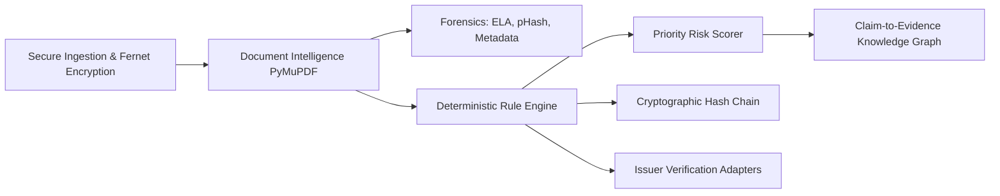

# AICTE SmartVerify AI: Decision-Support Scrutiny Platform
**Smart India Hackathon 2026 Prototype**

> [!IMPORTANT]
> **STATUTORY COMPLIANCE PRINCIPLE**:  
> **Decision-support system only.** No screen or automated API may auto-approve or auto-reject an application. Final approval or denial remains strictly with competent AICTE authorities. Every page displays the mandatory advisory banner.

---

## 1. Quick Start (One-Command Runnable Demo)

The entire prototype is 100% offline-ready, requires **zero paid APIs**, and runs locally with one command:

### Option A: Using Make (macOS/Linux or Windows with Make)
```bash
make demo
```

### Option B: Using Windows Batch Script
Double-click `run_demo.bat` or run in terminal:
```cmd
run_demo.bat
```

### Option C: Manual Launch (Python)
```bash
# 1. Generate synthetic dataset and deterministic keys
python data/generator.py

# 2. Start the AICTE SmartVerify Backend & Web UI
python backend/main.py
```
Open **[http://localhost:8000](http://localhost:8000)** in your web browser.

---

## 2. Seeded Demo Users (Role-Based Access)

| Role | Username | Password | Full Name / Institution |
| :--- | :--- | :--- | :--- |
| **Scrutiny Officer** (Default) | `officer_sharma` | `officer123` | Dr. R. K. Sharma (Senior Scrutiny Officer) |
| **Applicant** | `applicant_sit` | `applicant123` | Dr. A. K. Verma (Sunrise Institute of Technology) |
| **Admin** | `admin_aicte` | `admin123` | Director (Approval Bureau - AICTE) |
| **Auditor** | `auditor_cag` | `auditor123` | Compliance Officer (Statutory Vigilance & Audit) |

---

## 3. The Hero Demo Scenario: Sunrise Institute of Technology

The synthetic dataset includes **40 fictional institutions** and 40 applications. The hero institution is **"Sunrise Institute of Technology"** (`AICTE-SIT-001`, App ID: `APP-2026-SIT01`), injected with 6 realistic multi-layer regulatory discrepancies:

1. **Intake Mismatch**: Declares **120 seats** in application, but the AICTE baseline record permits only **60 seats** (`RULE-CROSS-INTK-003`).
2. **Cross-Institutional Document Reuse**: Its Fire Safety NOC SHA-256 fingerprint matches a document submitted by another institution, Pioneer Institute of Technology (`RULE-ANOM-DUPDOC-006`).
3. **Tampered Validity Date**: Affiliation certificate visually displays `2027-06-30`, but the cryptographic Ed25519 payload confirms expiration on `2024-06-30` (`RULE-DOC-AFFL-002`).
4. **Expired NBA Accreditation**: Accreditation certificate expired on `2024-05-31` (`RULE-DOC-ACCR-005`).
5. **Pending TER Payment**: Technical Education Regulatory fee is marked `PENDING` in the AICTE treasury database (`RULE-PAY-TER-004`).
6. **Near-Duplicate Photos**: Computer Lab and Library photographs exhibit identical visual perceptual hash fingerprints (pHash distance < 5).

### Expected Scrutiny Output:
- **Priority Risk Score**: **100.0** (High Risk) computed via transparent, deterministic formula:
  $$\text{Score} = \min(100, 35 \times \text{Critical} + 15 \times \text{Major} + 5 \times \text{Minor} + 10 \times \text{UnresolvedFailures})$$
  $$\text{Score} = \min(100, 35 \times 3 + 15 \times 3 + 5 \times 0 + 10 \times 1) = \min(100, 105 + 45 + 0 + 10) = \mathbf{100.0} \; (\text{High Risk})$$
- **Severity Breakdown**:
  - **3 Critical**: Cross-record declared intake mismatch (`RULE-CROSS-INTK-003`), cross-institutional Fire NOC reuse (`RULE-ANOM-DUPDOC-006`), visual vs signed validity date tampering (`RULE-DOC-AFFL-002`).
  - **3 Major**: Pending TER regulatory fee (`RULE-PAY-TER-004`), expired NBA accreditation (`RULE-DOC-ACCR-005`), near-duplicate infrastructure photos (`RULE-INFR-PHOTO-007`).
  - **1 Unresolved Issuer Verification**: Tampered token expiration mismatch from University adapter.
- **Assigned Outcome**: **"Manual review / inspection recommended"** (One of the 4 statutory non-binary outcome states).
- **Officer Action**: Scrutiny Officer clicks **"Refer for Physical Inspection"**, which records an immutable cryptographic audit record.

---

## 4. Frontend & Backend Architecture

### Frontend Technology Stack
- **Architecture**: Integrated Single-Page Application (SPA) served directly from FastAPI static files (`backend/static/index.html`).
- **Styling**: Modern, responsive layout with Tailwind CSS utility classes and custom AICTE portal tokens.
- **Visual Evidence Tools**:
  - **Bounding Box Viewer**: HTML5 Canvas 2D engine rendering normalized extracted coordinates over statutory documents.
  - **Claim-to-Evidence Knowledge Graph**: Dynamic SVG network graph visualizing claims, evidence documents, issuer adapters, and red conflict links.
  - **Notification Center & Audit Ledger**: Real-time alert feed and cryptographic hash-chain verification viewer with copyable hashes.
  - **Admin Studio**: Threshold tuning sliders with live effect feedback and rule-pack version control.

### Backend & AI Pipeline


### Comprehensive Simulated vs Real Component Breakdown:
| Component / Feature | Status | Implementation Details |
| :--- | :--- | :--- |
| **Deterministic Rule Engine** | **REAL** | Versioned YAML rule packs with strict indicator phrasing and zero auto-approve/reject. |
| **Document Intelligence** | **REAL** | PyMuPDF coordinate & bounding box layout extraction with scanned/noisy PDF support. |
| **Cryptographic Signatures** | **REAL** | Cryptography Ed25519 key-pair generation and tamper-detection signature verification. |
| **Audit Ledger** | **REAL** | SHA-256 append-only cryptographic hash chain with programmatic tamper detection. |
| **Image Forensics** | **REAL** | Error Level Analysis (ELA) and 256-bit perceptual image hashing (pHash distance < 5). |
| **File Storage Security** | **REAL** | Fernet AES-128 write-once encrypted storage with automated retention purge job. |
| **Privacy & PII Protection** | **REAL** | Deterministic regex masking for Indian Aadhaar, PAN, phone numbers, and email addresses. |
| **RAG Assistant** | **REAL** | Hybrid BM25 & semantic matching over statutory clauses citing `SYNTHETIC-DEMO` tags. |
| **Central AICTE Database** | **SIMULATED** | Seeded SQLite database representing central AICTE repository and baseline records. |
| **DigiLocker / University API** | **SIMULATED** | Local mock adapters simulating HTTP latency, JSON responses, and cryptographic tokens. |
| **Email Delivery** | **SIMULATED** | `simulated_emails.json` capturing simulated applicant and officer notifications. |
| **Statutory Handbooks** | **SIMULATED** | Synthetic Approval Process Handbook clauses labeled `SYNTHETIC-DEMO` for SIH 2026. |

---

## 5. Running the Tests & Evaluation Harness

```bash
# 1. Run Comprehensive Unit Tests (Risk formula, hash chain, check types, hero findings, RBAC, outcomes)
pytest backend/tests -v

# 2. Run Programmatic Evaluation Benchmark (Measured vs Target with 10-app held-out split)
python eval/harness.py
```

Benchmark results are stored in `eval/report.json` and `eval/report.md` and visible live on the **Evaluation** tab.

---

## 6. SIH 2026 Problem Statement: Requirement Traceability Matrix

This table maps every objective, functional requirement, and essential safeguard from the official AICTE Problem Statement directly to the codebase implementation:

| SIH 2026 Requirement / Objective | Implemented Solution | Codebase Module & Evidence |
| :--- | :--- | :--- |
| **1. Category Checklists & Completeness** | Automatic identification of application category (`EoA-Continuation`, `New-Programme`, `Intake-Change`) and evaluation of mandatory documents (`required_doc`), dates (`validity`), and required fields (`required_field`). | [`DeterministicRuleEngine`](file:///c:/aicte_project_5/backend/app/services/rules.py), [`EoA-Continuation.yaml`](file:///c:/aicte_project_5/rules/EoA-Continuation.yaml) |
| **2. Prior AICTE System Records** | Comparison of application declarations against central AICTE baseline records: approved intake, previous EoA status, accreditation status, deficiency count, and TER regulatory payment status (`RULE-PAY-TER-004`). | [`BaselineRecord`](file:///c:/aicte_project_5/backend/app/models/entities.py), [`cross_record` check](file:///c:/aicte_project_5/backend/app/services/rules.py#L134-L176) |
| **3. OCR & Intelligent Extraction** | Document text extraction with bounding boxes using PyMuPDF. Automated fallback to Tesseract OCR (`eng+hin` and `eng`) on scanned/noisy PDFs. Document classification strictly from content tokens without filename hints. | [`DocumentIntelligenceService`](file:///c:/aicte_project_5/backend/app/services/extraction.py#L35-L140) |
| **4. Anomaly & Forgery Detection** | Multi-layer digital forensics: Error Level Analysis (`ela_score`, `ela_indicator`), 256-bit pHash Hamming distance (`check_photo_near_duplicates`), PDF metadata non-statutory authoring tools, and fuzzy identity matching (`SequenceMatcher`). | [`AuthenticityForensicsService`](file:///c:/aicte_project_5/backend/app/services/forensics.py) |
| **5. Issuing Authority Verification** | Simulation of 4 issuing authorities (`AffiliatingUniversity`, `StateDTE`, `DigiLocker`, `FireSafetyAuthority`) supporting 7 distinct deterministic statuses (`VERIFIED`, `MISMATCH_DETECTED`, `EXPIRED`, `PENDING`, `SOURCE_UNAVAILABLE`, `NOT_SUPPORTED`, `MANUAL_REVIEW_REQUIRED`) with real Ed25519 cryptographic signatures and worst-status-wins aggregation. | [`IssuerVerificationManager`](file:///c:/aicte_project_5/backend/app/services/issuer_adapters.py) |
| **6. Infrastructure Evidence Assistance** | Computer vision image triage: Laplacian blur variance (< 50.0), 256-bit photo duplicate detection, and visual facility classification via Hough transforms and contour analysis without filename inputs. | [`InfrastructureEvidenceService`](file:///c:/aicte_project_5/backend/app/services/infra_evidence.py) |
| **7. Dashboard, Alerts & Graph** | Priority queue sorted by AICTE risk score, SVG Claim-to-Evidence Knowledge Graph, real-time alerts for gaps/expiry/anomalies, and simulated applicant email log. | [`ClaimToEvidenceGraphService`](file:///c:/aicte_project_5/backend/app/services/graph.py), [`AlertService`](file:///c:/aicte_project_5/backend/app/services/alerts.py) |
| **8. Audit Trail & Immutability** | Cryptographic append-only hash chain with canonical JSON (`sort_keys`), concurrency thread locks, external checkpoint (`head_hash` & `block_count`), and tail-deletion tamper detection. Access logging for all document views and failed logins. | [`AuditService`](file:///c:/aicte_project_5/backend/app/services/audit.py) |
| **9. Essential Safeguards (DPDP Act & Human Decisions)** | - Decision-support advisory banner on all views.<br>- Strictly 4 non-binary outcome states; zero auto-approval/rejection.<br>- Separate system `recommended_status` and human `workflow_status`.<br>- Fernet AES-128 file encryption & DPDP PII regex redaction.<br>- Retention purge scoped by case closure date.<br>- Role-based applicant scoping & cross-institution masking. | [`security.py`](file:///c:/aicte_project_5/backend/app/core/security.py), [`ingestion.py`](file:///c:/aicte_project_5/backend/app/services/ingestion.py), [`endpoints.py`](file:///c:/aicte_project_5/backend/app/api/endpoints.py) |

---

## 7. Technical Documentation & Function Reference

For detailed function signatures, parameters, return types, and architectural flow:
- 📖 **[Complete Functions Reference](file:///c:/aicte_project_5/docs/FUNCTIONS_README.md)**: Exhaustive catalog of every module, class, and service function across the platform.
- 🏛️ **[System Architecture Guide](file:///c:/aicte_project_5/docs/architecture.md)**: Deep dive into the 8 pipeline stages and cryptographic integrity.
- 🔒 **[DPDP Act & Privacy Compliance](file:///c:/aicte_project_5/docs/dpdp_compliance.md)**: Documentation of PII redaction patterns, Fernet encryption, and retention purge jobs.
- 📊 **[Evaluation Benchmark Report](file:///c:/aicte_project_5/eval/report.md)**: Full evaluation metrics across the 40 synthetic institutions and 10-application held-out set.
