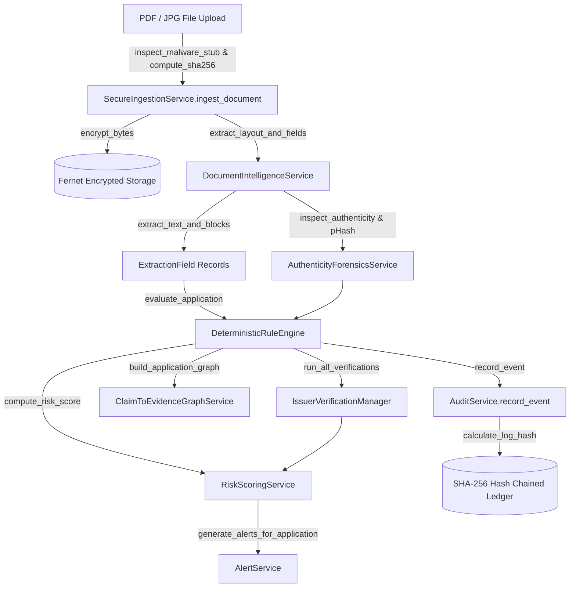

# AICTE SmartVerify AI: Complete Function & Module Reference
**Smart India Hackathon 2026 Prototype — Technical API & Function Documentation**

> [!IMPORTANT]
> **Statutory Principle**: AICTE SmartVerify AI is an AI-assisted decision-support platform. Functions are strictly designed for preliminary scrutiny, anomaly flagging, and evidence linking. No function or automated routine may approve or reject an application.

---

## Architecture Function Call Graph

---

## 1. Core Security & Privacy (`backend/app/core/security.py`)

Module providing Fernet AES-128 file-level encryption, deterministic regex PII redaction, password hashing, and JWT authorization.

### `encrypt_bytes(data: bytes) -> bytes`
- **Purpose**: Encrypts raw binary file payloads before writing to disk using a 32-byte Fernet key.
- **Parameters**: `data` (bytes) — Unencrypted document bytes.
- **Returns**: `bytes` — URL-safe base64-encoded ciphertext with timestamp and HMAC signature.

### `decrypt_bytes(token: bytes) -> bytes`
- **Purpose**: Decrypts stored ciphertext when authorized officers request document viewing.
- **Parameters**: `token` (bytes) — Ciphertext retrieved from disk storage.
- **Returns**: `bytes` — Plain document bytes.

### `mask_pii(text: str) -> str`
- **Purpose**: Redacts personally identifiable information (PII) to comply with DPDP Act 2023.
- **Parameters**: `text` (str) — Extracted text or log string.
- **Redaction Rules**:
  - **Aadhaar** (12 digits): `\b\d{4}\s?\d{4}\s?(\d{4})\b` $\to$ `XXXX-XXXX-$1`
  - **PAN** (10 chars): `\b([A-Z]{5})\d{4}([A-Z])\b` $\to$ `$1****$2`
  - **Phone** (10 digits): `\b(\+91[\-\s]?)?[6-9]\d{5}(\d{4})\b` $\to$ `+91-XXXXX-$2`
  - **Email**: `\b([a-zA-Z0-9_.+-])[a-zA-Z0-9_.+-]+@([a-zA-Z0-9-]+\.[a-zA-Z0-9-.]+)\b` $\to$ `$1***@$2`
- **Returns**: `str` — Masked string safe for auditing and display.

### `hash_password(password: str) -> str`
- **Purpose**: Creates salted SHA-256 password hash (`salt:hash`) for demo user accounts.
- **Parameters**: `password` (str) — Plaintext password.
- **Returns**: `str` — Formatted password hash string.

### `verify_password(plain_password: str, hashed_password: str) -> bool`
- **Purpose**: Validates login credentials against stored salt and hash.
- **Parameters**: `plain_password` (str), `hashed_password` (str).
- **Returns**: `bool` — `True` if credentials match.

### `create_access_token(data: dict, expires_delta: Optional[timedelta] = None) -> str`
- **Purpose**: Issues signed JWT containing username, role, and institution ID.
- **Parameters**: `data` (dict), `expires_delta` (Optional[timedelta]).
- **Returns**: `str` — Signed JWT token string.

### `decode_access_token(token: str) -> Optional[dict]`
- **Purpose**: Validates and decodes JWT token payload.
- **Returns**: `dict` or `None` if token is invalid or expired.

---

## 2. Ingestion & Storage Pipeline (`backend/app/services/ingestion.py`)

Manages secure upload, malware signature verification, integrity checks, and retention purging.

### `SecureIngestionService.inspect_malware_stub(raw_bytes: bytes) -> bool`
- **Purpose**: Scans file headers for suspicious executable headers (`MZ`, `ELF`, `<script>`, `powershell`).
- **Parameters**: `raw_bytes` (bytes) — Initial 512 bytes of file.
- **Returns**: `bool` — `True` if clean, `False` if malware signature detected.

### `SecureIngestionService.compute_sha256(raw_bytes: bytes) -> str`
- **Purpose**: Computes SHA-256 hexadecimal digest for cryptographic deduplication.
- **Parameters**: `raw_bytes` (bytes) — Complete file bytes.
- **Returns**: `str` — 64-character hex hash.

### `SecureIngestionService.check_integrity(raw_bytes: bytes, filename: str) -> Tuple[bool, int, str]`
- **Purpose**: Verifies that a PDF or image is uncorrupted, unencrypted, and readable.
- **Parameters**: `raw_bytes` (bytes), `filename` (str).
- **Returns**: `(is_valid: bool, page_count: int, corruption_reason: str)`.

### `SecureIngestionService.ingest_document(file_bytes: bytes, filename: str, doc_type: str, application_id: str, uploader_id: str) -> Dict[str, Any]`
- **Purpose**: Primary ingestion pipeline: validates malware stub, computes SHA-256, encrypts via Fernet, and writes `.enc` file to storage directory.
- **Returns**: Metadata dictionary (`storage_path`, `sha256_hash`, `page_count`, `is_corrupted`, `encrypted`).

### `SecureIngestionService.read_document_bytes(storage_path: str) -> bytes`
- **Purpose**: Reads encrypted file from disk and returns decrypted bytes in memory.
- **Parameters**: `storage_path` (str).
- **Returns**: `bytes` — Decrypted file content.

### `SecureIngestionService.purge_expired_records(retention_days: int = None) -> int`
- **Purpose**: Background purge job deleting encrypted documents exceeding configured retention window (`DATA_RETENTION_DAYS`, default 365 days).
- **Returns**: `int` — Count of purged files.

---

## 3. Document Intelligence & Layout Extraction (`backend/app/services/extraction.py`)

Parses PDF text streams and layout geometry via PyMuPDF (`fitz`), returning exact page bounding boxes.

### `DocumentIntelligenceService.extract_text_and_blocks(pdf_bytes: bytes) -> Dict[str, Any]`
- **Purpose**: Extracts raw text, word tokens, and coordinate bounding boxes `[x, y, w, h]` normalized to page dimensions.
- **Parameters**: `pdf_bytes` (bytes) — Decrypted PDF file bytes.
- **Returns**: Dictionary with `full_text`, `page_count`, and `blocks` containing per-page geometry.

### `DocumentIntelligenceService.classify_document(text: str, filename: str) -> str`
- **Purpose**: Identifies statutory document type (`NOC-Fire`, `NOC-Affiliating University`, `NOC-State Govt`, `Accreditation-Certificate`, `Building-Plan`, `TER payment receipt`) using keyword heuristics.
- **Parameters**: `text` (str), `filename` (str).
- **Returns**: `str` — Standardized AICTE document category.

### `DocumentIntelligenceService.extract_dates(text: str) -> List[str]`
- **Purpose**: Uses regular expressions to extract and ISO-normalize validity dates (`YYYY-MM-DD`).
- **Parameters**: `text` (str).
- **Returns**: `List[str]` — Normalized date strings.

### `DocumentIntelligenceService.extract_intake(text: str) -> Optional[int]`
- **Purpose**: Locates declared student intake capacity figures in approval orders.
- **Returns**: `int` or `None`.

### `DocumentIntelligenceService.extract_qr_payload(pdf_bytes: bytes) -> Optional[str]`
- **Purpose**: Scans PDF raster renders for embedded QR code symbols using OpenCV `cv2.QRCodeDetector` to retrieve signed tokens.
- **Returns**: `str` (decoded QR content) or `None`.

---

## 4. Authenticity Forensics & Image Hashing (`backend/app/services/forensics.py`)

Detects cross-institutional document reuse, PDF manipulation, and photo duplicate reuse.

### `AuthenticityForensicsService.compute_perceptual_hash(image_bytes: bytes) -> str`
- **Purpose**: Computes a 64-character (256-bit) perceptual hash (pHash) on 16×16 grayscale DCT matrices to identify visually identical photos despite re-compression.
- **Parameters**: `image_bytes` (bytes).
- **Returns**: `str` — 64-character hex hash string.

### `AuthenticityForensicsService.compare_phashes(hash1: str, hash2: str) -> float`
- **Purpose**: Measures Hamming distance between two pHash signatures.
- **Returns**: `float` — Similarity percentage ($0.0\%$ to $100.0\%$). Distance $\le 5$ bits indicates duplicate image reuse.

### `AuthenticityForensicsService.perform_error_level_analysis(image_bytes: bytes, quality: int = 90) -> Dict[str, Any]`
- **Purpose**: Resaves JPEG at known quality and measures pixel difference variance to spot digital splicing/tampering.
- **Returns**: `{"ela_score": float, "is_tampered": bool, "details": str}`.

### `AuthenticityForensicsService.inspect_pdf_metadata(pdf_bytes: bytes) -> Dict[str, Any]`
- **Purpose**: Inspects PDF producer, creation dates, modifying software, and font embedding anomalies.
- **Returns**: `{"producer": str, "suspicious_tools_detected": List[str]}`.

### `AuthenticityForensicsService.find_duplicate_documents(db: Session, sha256_hash: str, current_app_id: str) -> List[Dict[str, Any]]`
- **Purpose**: Queries database to detect if another institution previously submitted a file with the identical SHA-256 fingerprint.
- **Returns**: List of matching records across prior submissions.

---

## 5. Deterministic Rule Engine (`backend/app/services/rules.py`)

Executes versioned YAML regulatory rule packs without non-deterministic AI variance.

### `DeterministicRuleEngine.load_rules_for_category(db: Session, category: str) -> List[Dict[str, Any]]`
- **Purpose**: Loads active rules for application category (`EoA-Continuation`, `New-Programme`, `Intake-Change`) from database or fallback YAML.
- **Returns**: List of rule definition dictionaries.

### `DeterministicRuleEngine.evaluate_application(db: Session, app_id: str, actor_role: str = "Scrutiny Officer") -> List[Dict[str, Any]]`
- **Purpose**: Evaluates all rules against application documents and baseline AICTE records. Creates or updates `Finding` entities.
- **Supported Check Types**:
  - `required_doc`: Verifies existence of mandatory statutory submissions.
  - `validity`: Checks expiration date against academic year and verifies visual date matches signed QR payload.
  - `cross_record`: Flags discrepancy between declared student intake and AICTE approved baseline.
  - `threshold`: Validates payment status (`PAID` vs `PENDING`).
  - `anomaly_duplicate`: Checks SHA-256 match against prior applications.
  - `anomaly_photo_duplicate`: Flags pHash similarity $\ge 90.0\%$ across facility photographs.
- **Mandatory Indicator Phrasing**: All plain reasons end with indicator framing (e.g., `": indicator requiring human verification"`).
- **Returns**: `List[Dict[str, Any]]` — Formatted findings.

---

## 6. Priority Risk Scoring & Outcome Transitions (`backend/app/services/risk.py`)

Computes deterministic risk score and manages the 4 strictly non-binary statutory outcome states.

### `compute_risk_score(critical_count: int, major_count: int, minor_count: int, unresolved_verifications: int) -> Dict[str, Any]`
- **Formula**:
  $$\text{Score} = \min(100, 35 \times \text{Critical} + 15 \times \text{Major} + 5 \times \text{Minor} + 10 \times \text{UnresolvedFailures})$$
- **Risk Bands**:
  - `High`: Score $\ge 70.0$
  - `Medium`: $40.0 \le \text{Score} < 70.0$
  - `Low`: $10.0 \le \text{Score} < 40.0$
  - `Minimal`: $\text{Score} < 10.0$
- **Returns**: Dictionary with `score`, `band`, `formula`, and subtotal `breakdown`.

### `RiskScoringService.calculate_and_update_application_risk(db: Session, app_id: str) -> Dict[str, Any]`
- **Purpose**: Queries findings and unresolved issuer verifications for `app_id`, calculates score, updates `Application` record, and assigns non-binary preliminary status.
- **Non-Binary Outcome Rules**:
  - Any Critical finding $\to$ `Manual review / inspection recommended`
  - Any Major finding $\to$ `Rectification required`
  - Zero defects $\to$ `Ready for official scrutiny`
  - Initial/in-progress $\to$ `Preliminary check complete`
- **Returns**: Calculated risk result dictionary.

---

## 7. Issuer Verification Adapters (`backend/app/services/issuer_adapters.py`)

Simulates statutory issuer verification protocols with local cryptographic signature checking.

### `QRSignedRecordAdapter.verify(doc_type, cert_no, institution_id, payload_data) -> Dict[str, Any]`
- **Purpose**: Verifies Ed25519 cryptographic signatures extracted from QR payloads. Checks for visual date vs signed record divergence.
- **Returns**: `{"status": "VERIFIED" | "MISMATCH_DETECTED" | "MANUAL_REVIEW_REQUIRED", ...}`.

### `DigiLockerAdapter.verify(doc_type, cert_no, institution_id, payload_data) -> Dict[str, Any]`
- **Purpose**: Simulates national DigiLocker API registry lookup for Fire NOCs and statutory receipts.
- **Returns**: Verification response dictionary.

### `AffiliatingUniversityAdapter.verify(doc_type, cert_no, institution_id, payload_data) -> Dict[str, Any]`
- **Purpose**: Simulates state university portal registry verification for affiliation orders.
- **Returns**: Verification response dictionary.

### `IssuerVerificationManager.run_all_verifications(doc_type, cert_no, institution_id, payload_data) -> Dict[str, Any]`
- **Purpose**: Dispatches document credentials across appropriate adapters in parallel.
- **Returns**: Aggregated verification report with `primary` and `all_results`.

---

## 8. Claim-to-Evidence Knowledge Graph (`backend/app/services/graph.py`)

Builds an interactive graph linking institutional claims to documents, rule findings, and issuer endpoints.

### `ClaimToEvidenceGraphService.build_application_graph(db: Session, app_id: str) -> Dict[str, Any]`
- **Purpose**: Constructs node and edge representations for the UI's SVG graph viewer.
- **Node Categories**:
  - `Institution` (Central anchor)
  - `Claim` (Intake capacity, Faculty ratio, Safety clearance)
  - `Document` (Uploaded PDF/JPG evidence)
  - `Rule` (Evaluated statutory clause)
  - `Issuer` (DigiLocker, Ed25519 QR, Affiliating University)
- **Edge Styling**:
  - `SUPPORTED`: Green/blue connection.
  - `CONFLICT`: Red highlighted edge indicating a defect finding or mismatch.
- **Returns**: `{"nodes": List[dict], "edges": List[dict]}`.

---

## 9. Infrastructure Evidence & Photo Triage (`backend/app/services/infra_evidence.py`)

Assesses quality and authenticity of uploaded physical infrastructure photographs.

### `InfrastructureEvidenceService.assess_photo_quality(image_bytes: bytes) -> Dict[str, Any]`
- **Purpose**: Computes Laplacian variance (blur detection), brightness histogram, and pixel resolution.
- **Thresholds**: Blur variance $< 50.0 \to$ Flagged as blurry.
- **Returns**: `{"is_blurry": bool, "laplacian_variance": float, "brightness": float, "resolution": str}`.

### `InfrastructureEvidenceService.classify_facility_type(filename: str) -> str`
- **Purpose**: Identifies facility category (`Computer Lab`, `Library`, `Classroom`, `Seminar Hall`, `Workshop`).
- **Returns**: `str` — Normalized facility type.

### `InfrastructureEvidenceService.triage_photos_for_application(db: Session, app_id: str) -> Dict[str, Any]`
- **Purpose**: Analyzes all photos for an application, identifies near-duplicates via pHash, and generates triage recommendations.
- **Returns**: Triage report with quality ratings and flagged duplicates.

---

## 10. Synthetic Handbook RAG Assistant (`backend/app/services/rag.py`)

Offline hybrid lexical/semantic retrieval system over Approval Process Handbook clauses.

### `SyntheticHandbookRAGService.load_handbook_clauses() -> List[Dict[str, Any]]`
- **Purpose**: Loads and parses `knowledge_base/synthetic_handbook_clauses.md`.
- **Returns**: List of structured clause objects tagged with `SYNTHETIC-DEMO` labels.

### `SyntheticHandbookRAGService.query(query_text: str, category_filter: Optional[str] = None, top_k: int = 3) -> Dict[str, Any]`
- **Purpose**: Performs hybrid search across clauses. Returns matching excerpts with exact clause numbers or an explicit abstain message (*"Not found in knowledge base"*).
- **Returns**: `{"query": str, "matches": List[dict], "statutory_disclaimer": str}`.

---

## 11. Alerts & Simulated Communications (`backend/app/services/alerts.py`)

Dispatches in-app priority notifications and logs applicant correspondence.

### `AlertService.generate_alerts_for_application(db: Session, app_id: str) -> List[Alert]`
- **Purpose**: Generates high-priority alerts for applications exhibiting score $\ge 40.0$, pending issuer verifications, or document tampering.
- **Returns**: List of created `Alert` database records.

### `AlertService.send_simulated_email(to_email: str, subject: str, body: str, alert_type: str, app_id: str) -> Dict[str, Any]`
- **Purpose**: Simulates outbound SMTP communication by appending JSON message objects to `data/simulated_emails.json`.
- **Returns**: Email record dictionary with dispatch timestamp.

### `AlertService.get_simulated_emails() -> List[Dict[str, Any]]`
- **Purpose**: Retrieves history of simulated emails for reviewer audit.
- **Returns**: List of email objects.

---

## 12. Cryptographic Hash-Chained Audit Ledger (`backend/app/services/audit.py`)

Provides immutable, append-only provenance tracking for all regulatory evaluations and officer decisions.

### `calculate_log_hash(prev_hash: str, timestamp: str, actor_id: str, actor_role: str, action: str, target_id: str, details_json: str) -> str`
- **Purpose**: Computes SHA-256 block hash chaining the current event to the prior block's hash.
- **Formula**: `SHA-256(prev_hash + "|" + timestamp + "|" + actor_id + "|" + actor_role + "|" + action + "|" + target_id + "|" + details_json)`.
- **Returns**: 64-character hex hash string.

### `AuditService.record_event(db: Session, actor_id: str, actor_role: str, action: str, target_type: str, target_id: str, details: Dict[str, Any]) -> AuditLog`
- **Purpose**: Appends an audited action to the ledger. Fetches latest block hash, calculates new hash, masks PII in details, and persists to database.
- **Returns**: Created `AuditLog` entity.

### `AuditService.verify_chain_integrity(db: Session) -> Tuple[bool, int, List[str]]`
- **Purpose**: Traverses entire audit ledger sequentially from genesis block, recalculating every hash. Spots any unauthorized manual database alteration.
- **Returns**: `(is_valid: bool, records_checked: int, errors: List[str])`.

---

## 13. REST API Endpoint Handlers (`backend/app/api/endpoints.py`)

FastAPI route handlers serving the integrated single-page application.

| HTTP Method | Route | Handler Function | Role Required | Purpose |
| :--- | :--- | :--- | :--- | :--- |
| `POST` | `/api/auth/login` | `login()` | Public | Authenticates credentials and issues JWT. |
| `GET` | `/api/applications` | `list_applications()` | Any | Retrieves priority-sorted application queue with live KPIs. |
| `GET` | `/api/applications/{id}` | `get_application_detail()` | Any | Fetches full scrutiny dossier with findings, baseline, and verifications. |
| `POST` | `/api/applications/{id}/action` | `perform_officer_action()` | Scrutiny Officer, Admin | Transitions application to 1 of 3 allowed reviewer outcome states. |
| `POST` | `/api/findings/{id}/review` | `review_finding()` | Scrutiny Officer, Admin | Records reviewer feedback (`Confirmed` / `False positive`). |
| `GET` | `/api/documents/{id}/view` | `view_document_bytes()` | Any authenticated | Serves decrypted PDF/image bytes for in-browser inspection. |
| `POST` | `/api/applicant/upload` | `applicant_upload()` | Applicant, Admin | Ingests rectification document, re-evaluates rules, and updates score. |
| `GET` | `/api/applications/{id}/graph` | `get_application_graph()` | Any | Returns nodes/edges for Claim-to-Evidence Knowledge Graph. |
| `POST` | `/api/applications/{id}/verify-issuer` | `run_issuer_verification()` | Scrutiny Officer, Admin | Executes issuer adapters across submitted documents. |
| `POST` | `/api/rag/query` | `rag_search()` | Any | Hybrid search assistant querying synthetic handbook clauses. |
| `GET` | `/api/audit` | `get_audit_trail()` | Any | Lists recent hash-chained audit events. |
| `POST` | `/api/audit/verify` | `verify_audit_chain()` | Any | Programmatically validates audit hash-chain integrity. |
| `GET` | `/api/admin/thresholds` | `list_thresholds()` | Admin | Returns current anomaly detection thresholds. |
| `PUT` | `/api/admin/thresholds/{id}` | `update_threshold()` | Admin | Adjusts detector threshold value and logs change to audit trail. |
| `GET` | `/api/admin/rule-packs` | `list_rule_packs()` | Admin | Lists active regulatory rule packs. |
| `PUT` | `/api/admin/rule-packs/{id}` | `update_rule_pack()` | Admin | Modifies rule pack version and status. |
| `POST` | `/api/admin/purge-retention` | `trigger_retention_purge()` | Admin | Executes automated data retention purge job. |
| `GET` | `/api/alerts` | `get_alerts()` | Any | Returns real-time notification center alerts. |
| `GET` | `/api/alerts/emails` | `get_simulated_emails()` | Any | Returns outbound simulated email notification log. |

---

## 14. Synthetic Data Generation (`data/generator.py`)

Generates the 40 fictional institutions, statutory PDFs, signed QR codes, and ground truth.

### `generate_demo_keypair() -> Tuple[ed25519.Ed25519PrivateKey, ed25519.Ed25519PublicKey]`
- **Purpose**: Generates deterministic Ed25519 keypair for offline digital signatures.
- **Returns**: Private key and public key written to `data/demo_public_key.pem`.

### `create_synthetic_pdf(filepath: str, title: str, institution_name: str, institution_id: str, fields: dict, qr_payload: Optional[str] = None)`
- **Purpose**: Generates vector PDF with statutory text layout, watermarks, metadata, and embedded QR code.
- **Parameters**: `filepath` (str), `title` (str), `institution_name` (str), `institution_id` (str), `fields` (dict), `qr_payload` (Optional[str]).

### `create_synthetic_photo(filepath: str, facility_type: str, institution_name: str, room_label: str)`
- **Purpose**: Generates facility JPG with visual geometric structures (desks, monitors, bookshelves) for pHash testing.

### `generate_all_data()`
- **Purpose**: Main data generation routine. Creates 40 institutions across 3 categories, generates 175 PDFs and images, seeds baseline central records, and exports `ground_truth.json`.

---

## 15. Benchmark Evaluation Harness (`eval/harness.py`)

Measures performance against `ground_truth.json` with programmatic PASS/FAIL validation.

### `EvaluationHarness.run_full_evaluation() -> Dict[str, Any]`
- **Purpose**: Runs end-to-end benchmark across all 40 applications.
- **Telemetry Measured**:
  - Classification accuracy (target $\ge 95\%$)
  - OCR coordinate extraction (target $\ge 95\%$)
  - Precision and Recall (target $\ge 90\%$ and $\ge 95\%$)
  - Issuer verification success (target $\ge 95\%$)
  - Processing time (target $\le 5.0\text{ s}$)
  - Alert notification latency (target $\le 200\text{ ms}$)
  - Manual effort reduction (target $\ge 75\%$)
- **Reports Exported**: `eval/report.json` and `eval/report.md`.
